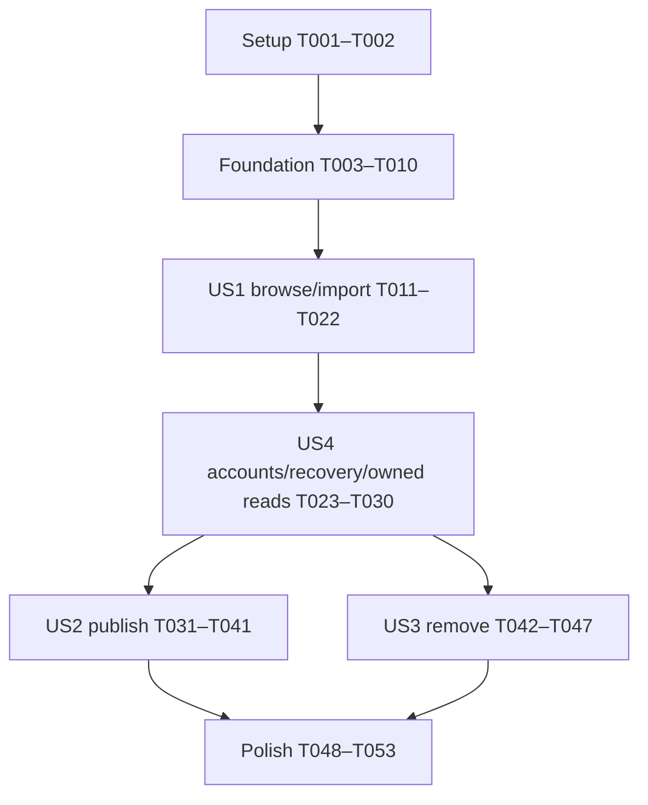

# Tasks: BlueShare 3.0 Parity

**Status**: Closed — 2026-10-18. All 116 entries are resolved: 111 completed and 5 platform
gates waived by explicit owner approval. Waived tests were not run and remain unverified.
The final closure record below supersedes earlier pending-gate and next-command statements.

**Input**: [spec.md](spec.md), [plan.md](plan.md), [research.md](research.md), [data-model.md](data-model.md), [service API](contracts/service-api.md), [desktop contract](contracts/desktop.md), and [quickstart.md](quickstart.md).

**Prerequisites**: Feature 117 design and 16 specification-quality checks pass. The implemented blue-site v1 contract is verified at source revision `20df3f93185b60a6677999a4820405215c9e4f3a`; recorded service verification is not desktop verification.

**Verification**: Include constitution-required serialization, atomic failure, boundary-contract, native-session, UI, cross-platform and history verification. Write focused tests before the corresponding behavior where the harness supports it; expected initial failures do not authorize weaker assertions. Do not rerun unrelated service/dependency work without a changed contract or failure.

**Approved amendment (2026-10-18)**: The owner selected TanStack Query for renderer request state. Phases 1–8 are completed records, including their original no-new-dependency decisions; current scope is governed by spec FR-018–019, plan Decision 7 and Phases 9–11 below. Continue with `$speckit-implement`; do not regenerate tasks or repair the replaced manual request machinery first. All prior completed markers and existing IDs remain intact.

**Organization**: Story labels retain the spec numbering. Priority order is US1 (P1), US4 (P1), US2 (P2), US3 (P2). P2 stories remain mandatory for the 3.0 parity release.

## Format: `[ID] [P?] [Story] Description`

- Every task has a stable ID and exact repository-relative file paths. New IDs follow the previous maximum; amendments preserve existing IDs. Execute in phase/list order and honor explicit dependencies, not numeric ID sorting.
- `[P]` identifies disjoint-file work that can run alongside the other ready tasks in its documented wave after prerequisites complete. It does not authorize concurrent edits to shared modules.
- Setup/foundation/polish tasks have no story label. Story tasks use the original `[US1]`–`[US4]` labels.
- Checkboxes indicate resolved work: completion requires its stated evidence or an explicit owner-approved waiver labelled on the task. A checked waived gate is not an executed test pass.

## Path Conventions

- Application contracts, services, UI and tests stay under `packages/blue-app/`.
- Reuse `packages/blue-data/src/resource-xml-policy.ts` and existing library metadata APIs without introducing host code or a new format policy there.
- Existing files named below are extended surgically; new feature/test files are created only when their tasks require them.
- All `pnpm` commands run from the repository root. Use original synthetic fixtures and disposable profiles/databases; production discovery is read-only.

## Phase 1: Setup (Shared Infrastructure)

**Purpose**: Confirm the existing boundaries and establish original fixtures without adding dependencies or changing service data.

- [X] T001 Reconfirm license scopes, authoritative Java panes/import-folder behavior and feature 116 loader/writer history against `LICENSING.md`, `packages/blue-app/THIRD_PARTY_NOTICES.md`, `packages/blue-data/THIRD_PARTY_NOTICES.md`, `specs/116-xml-compatibility-contracts/resource-evidence.md`, and the source revisions/paths in `specs/117-blueshare-parity/research.md`; record only changed evidence there, retain the original-code-only/no-new-dependency decision, and block unresolved code/fixture incorporation rather than translating Java/site code or copying community uploads (Constitution II, V, VI).
- [X] T002 Create original fixture builders and a controllable fake request adapter in `packages/blue-app/src/main/blueshare/test-helpers.ts` for all three kinds, at least 25 summaries per kind, overlapping IDs, nested/empty categories, nullable metadata, standalone supported/current/historical/invalid resources, delayed replies and lost committed-write replies; generate resource XML from existing models or documented synthetic forms, never production payloads, and use existing temporary SQLite/profile helpers with `path.join()`/`os.tmpdir()`.

**Checkpoint**: Provenance is explicit and reusable fixtures are available; no project/service/schema change has occurred.

## Phase 2: Foundational (Blocking Prerequisites)

**Purpose**: Establish typed boundaries, native transport and context lifetime shared by all stories. No story implementation starts before this phase passes.

### Required verification

- [X] T003 [P] Add shared DTO/request/result guard tests in `packages/blue-app/src/shared/blueshare.test.ts` for every entity/field constraint quoted in T005, malformed success/error envelopes, bounded errors/diagnostics, sanitized identity without email/proof, forged unknown request fields, and the complete method/event surface in `specs/117-blueshare-parity/contracts/desktop.md`; tests must fail for unchecked casts or success-shaped invalid replies.
- [X] T004 [P] Add transport tests in `packages/blue-app/src/main/blueshare/transport.test.ts` for fixed-origin route construction, rejection of renderer URLs and every redirect, exact mutation Origin, native Session use with all cookie handling delegated to Chromium, no default/persistent-session sharing, a 30-second total deadline including body reading, 16 MiB response cap, invalid JSON/statuses, sanitized errors and no automatic write retry (FR-010–013, FR-017).

### Shared contracts and transport

- [X] T005 Define static serializable DTOs, channel constants and runtime guards in `packages/blue-app/src/shared/blueshare.ts`: ResourceKind is “Exactly `instrument`, `effect`, `soundObject`; never a display label or Java class name.”; ResourceKey is “`{kind, id}`; ID is integer 1–2147483647. Kind is required because IDs overlap.”; Category is “`{kind,id,parentId,name,description}`; nullable parent/description. Parent references same-kind existing category; reject cycles/duplicates/orphans. Preserve ID order among siblings.”; ResourceSummary has “Key, name, nullable description/blueType/createdAt, `category:{id,name}`, `author:{id,name,username}`. Dates are null or valid UTC ISO strings. Effects have null type. Public author is not login email.”; ResourceDetail has “Summary plus complete `xml` string.” only at the main HTTP boundary; ResourcePage has “Summaries and `nextBeforeId:number|null`; strict descending IDs, no duplicate kind/IDs, bounded page size.”; LatestResult has “Up to ten summaries of one kind; creation descending, null dates last, ID descending for ties. No pagination.”; AccountIdentity has “`{id,name,username}` and optional session expiry after session GET; never cookies/token/email.”; include failure “outcome `rejected | unknown`”, optional structured XML diagnostics/field errors/HTTP status/retry-after, and distinct synthetic navigation nodes with “no numeric ID” (depends on T003; FR-002–003, FR-009–013).
- [X] T006 Implement the native adapter in `packages/blue-app/src/main/blueshare/transport.ts` using Electron `session.fromPartition` after readiness with a unique non-`persist:` partition and `{cache:false}`, `net.request`, `credentials:'include'`, `redirect:'error'`, `cache:'no-store'`, exact configured origin and known v1 routes; default to `https://blue3.kunstmusik.com`, allow loopback HTTP only through test injection, count response bytes before parsing, bound the whole operation to 30 seconds, and never expose/log cookies, raw bodies or credentials (depends on T004–T005).
- [X] T007 Add context/lifetime tests in `packages/blue-app/src/main/blueshare/service-context.test.ts` for sender-bound open/close, destroyed senders, invalid context/request IDs, one pending import/publish/remove slot per dialog, cancellation before side effects, stale completions, sanitized account events and explicit failure versus empty result; use the injected adapter and do not require a real project or signed-in account.
- [X] T008 Implement the shared service context owner in `packages/blue-app/src/main/blueshare/service.ts`: DialogContext is an “opaque ID tied to requesting `webContents`, opening generation, and at most one publish source snapshot”; OperationContext carries request/context identity, abort handle and protected account epoch with state “`pending → success | failure | cancelled | uncertain`”; enforce “One import/publish/remove slot per dialog”, close/destruction/shutdown cleanup and pre-side-effect fence checks, while keeping all state transient and leaving the canonical library/project owners untouched (depends on T006–T007).
- [X] T009 Add registrar/preload tests in `packages/blue-app/src/main/blueshare/ipc.test.ts` and `packages/blue-app/src/preload/blueshare.test.ts` for malformed input/output, wrong senders/contexts, exception-to-failure conversion, checked account events, unsubscribe/disposal and duplicate-safe registration rollback; begin with open/close/account-state methods and extend these tests in the relevant stories (depends on T005, T008).
- [X] T010 Implement base open/close/account-state registration in `packages/blue-app/src/main/blueshare/ipc.ts`, checked preload methods/events in `packages/blue-app/src/preload/preload.ts` and declarations in `packages/blue-app/src/renderer/types/global.d.ts`; initialize/dispose the service after the unified library using the existing startup/rollback lease in `packages/blue-app/src/main/main.ts`, and extend `packages/blue-app/src/main/ipc/main-process-ipc-inventory.test.ts` without changing existing endpoints or teardown order (depends on T008–T009).

**Checkpoint**: Run the new shared/transport/context/IPC/preload suites through `pnpm --filter @blue/app test` with selected files, plus main/preload builds. Native cookie behavior receives a real Electron check in US4; fake transport tests alone do not establish it.

## Phase 3: User Story 1 — Discover and import resources (Priority: P1) — MVP

**Goal**: Anonymous category/latest browsing, details and safe import into existing user libraries for all three kinds, with no active project mutation.

**Independent Test**: Using original controlled resources, browse all categories/pages/latest views, import a supported current/historical item of each kind, verify immediate library visibility/restart persistence, then reject malformed/unsupported/unavailable inputs without partial changes. No account, publisher or removal implementation is required.

### Verification for User Story 1

- [X] T011 [P] [US1] Add anonymous read/detail contract tests in `packages/blue-app/src/main/blueshare/service-browse.test.ts` for complete ordered category trees, direct-member category pages of 25, exclusive `beforeId` continuation/null completion, independent latest-ten, overlapping kind IDs, nullable metadata and creation ties, 404/409/410/503 distinctions, bounded bodies, stale selections and details that never expose raw XML over preload (FR-002–003, FR-005, FR-017).
- [X] T012 [P] [US1] Add real-SQLite atomic import tests in `packages/blue-app/src/main/unified-library/blueshare-import.test.ts` for Imported folder creation/reuse, same-name item collisions, duplicate folders ordered by `(sortIndex,id)`, concurrent imports, independent copies, single content-revision advancement and rollback of folder/item/payload/order/revision on injected failure; include durable-commit versus post-commit snapshot-refresh failure and restart persistence (FR-004–005).
- [X] T013 [P] [US1] Add standalone acceptance tests in `packages/blue-app/src/main/unified-library/blueshare-resource-acceptance.test.ts` using T002 fixtures and existing feature 116 evidence for all kinds: current/historical defaults and conflicts, nested unknown members/types/values, significant whitespace, stable re-normalization, copy/save/reload without aliases or meaningful loss, and diagnostics naming resource/path/member/value/severity/recovery; reject unsupported archive fallback and separate supported serialization from unavailable Jython/Clojure/other runtimes (FR-005, FR-015).
- [X] T014 [P] [US1] Add Import interaction tests in `packages/blue-app/src/renderer/tests/blueshare-import.test.tsx` for three groups × three tabs, category/list/details organization, read-only descriptions with line breaks, explicit loading/empty/error/unavailable states, Load More only for category pages, disabled invalid/pending Import, immediate modal feedback and stale kind/category/detail/closed-dialog responses (FR-001–005, FR-012–013, FR-016).

### Implementation for User Story 1

- [X] T015 [US1] Implement public category, page, latest and detail methods in `packages/blue-app/src/main/blueshare/service.ts` using the v1 mappings and guards, complete flat-tree validation, direct-member semantics, page size 25, explicit 404/409/410 failures and sanitized detail display DTOs; construct source labels from kind/ID/name and never put a service URL in `XmlSource.nativePath` (depends on T011).
- [X] T016 [US1] Add one imported-resource transaction in `packages/blue-app/src/main/unified-library/repository.ts` and worker/client delegates in `packages/blue-app/src/main/unified-library/repository-worker.ts` and `packages/blue-app/src/main/unified-library/repository-client.ts`: inspect only direct folders under the matching user root, reuse the exact Imported name by `(sortIndex,id)`, create folder/item/payload atomically, advance content revision once and return detached results; add no schema, provenance or sync store (depends on T012).
- [X] T017 [US1] Add accepted standalone import to `packages/blue-app/src/main/unified-library/service.ts`, requiring `readResourceXml(...).ok` before `parseRawXmlDocument`/classification, preserving original accepted XML/hash/code whitespace and existing canonical/preview/dependency metadata, using embedded name for resource content and the original typed diagnostics; call T016, publish the existing library-change event/receipt only for the durable outcome, and recover a post-commit refresh failure without repeating the import (depends on T013, T016).
- [X] T018 [US1] Connect read/detail/import intents through `packages/blue-app/src/main/blueshare/service.ts`, `packages/blue-app/src/main/blueshare/ipc.ts`, `packages/blue-app/src/preload/preload.ts` and `packages/blue-app/src/renderer/types/global.d.ts`; fetch by validated remote key, semantically accept before durable mutation, recheck context/pending fences before commit, and return structured failures or the library receipt without model aliases, arbitrary renderer XML, code execution or asset downloads (depends on T015–T017; extend T009 tests).
- [X] T019 [US1] Implement transient view state and Import UI in `packages/blue-app/src/renderer/components/blueshare/use-blueshare.ts`, `packages/blue-app/src/renderer/components/blueshare/BlueShareDialog.tsx` and `packages/blue-app/src/renderer/components/blueshare/BlueShareModal.tsx`; retain the three resource groups/three-tab arrangement, existing focus/modal/typography conventions, category tree/Latest/list/details/Import layout, request/context/selection fencing, immediate pending feedback, and explicit currently unavailable protected actions rather than false completion (depends on T014, T018).
- [X] T020 [US1] Enable Tools → Blue Share and add `open-blue-share` wiring in `packages/blue-app/src/main/application-menu.ts`, `packages/blue-app/src/shared/workbench-menu.ts`, `packages/blue-app/src/main/main.ts`, `packages/blue-app/src/renderer/stores/workbench-store.ts` and `packages/blue-app/src/renderer/App.tsx`; update `packages/blue-app/src/main/application-menu.test.ts` and menu-dispatch tests to replace the intentionally disabled baseline without introducing a placeholder alert or new window framework (depends on T019).
- [X] T021 [US1] Add project-isolation and downstream insertion regressions in `packages/blue-app/src/main/unified-library/blueshare-project-isolation.test.ts` with existing project/history helpers: imports/read failures preserve active content, dirty state, history and runtime; later instrument/effect/SoundObject insertion must use the existing semantic history labels and commit→undo→redo restoration of canonical state, stable IDs/references, dirty state and applicable engine reconciliation; cancelling insertion previews restores canonical state (depends on T017–T018; FR-014).
- [X] T022 [US1] Run the US1 suites, main/preload/renderer checks, and anonymous browse/import/restart acceptance from `specs/117-blueshare-parity/quickstart.md`; record current/historical supported cases, invalid-case atomicity, all-kind library refresh and unchanged-project evidence there, without declaring full parity or testing writes against production (depends on T011–T021).

**Checkpoint**: Anonymous browsing/import is a demonstrable MVP. All nine tabs are reachable, but Export/Manage remain explicitly incomplete until their story checkpoints pass.

## Phase 4: User Story 4 — Use current accounts and recover from failures (Priority: P1)

**Goal**: Native session lifecycle, registration/recovery links, owned-list reads and reliable error/recovery behavior without losing local work. Owned-list reads are introduced here as a protected-action/session probe reused by both P2 stories; removal is still US3.

**Independent Test**: With pre-seeded isolated accounts/catalog data, sign in/out, fetch owned pages, expire/replace sessions and delay/fail requests; public Import stays usable. Exercise restart/origin changes and native cookie behavior without publishing or removing a resource.

### Verification for User Story 4

- [X] T023 [P] [US4] Add account and protected-read contract tests in `packages/blue-app/src/main/blueshare/service-account.test.ts` for email/password sign-in, sanitized identity, opaque cookie proof, session GET expiry, no cookie-cache refresh assumption, owner-scoped `/mine` pages, invalid/expired sessions versus service failures, fixed registration/recovery URLs, offline revocation failure, late login/cookie updates, account replacement and exact-origin cutover (FR-009–013).
- [X] T024 [P] [US4] Add account/recovery UI tests in `packages/blue-app/src/renderer/tests/blueshare-account.test.tsx` for transient form input, visible identity, prompt clearing, sign-in/out status, recovery links, paginated Fetch of pre-seeded owned submissions, state/epoch events, one-second pending feedback, readable 401/403/429/503/504 errors, stale responses and continued anonymous browsing without treating failure as empty results (FR-009–013, FR-016).

### Implementation for User Story 4

- [X] T025 [US4] Implement account/session and owner-list orchestration in `packages/blue-app/src/main/blueshare/service.ts` and session-context rotation in `packages/blue-app/src/main/blueshare/transport.ts`: AccountState is “`signedOut`, `signingIn`, `signedIn`, `signingOut`, or `unavailable`”, with “monotonic main-owned `accountEpoch`”; only signed-in state permits protected actions, every new account attempt/origin gets a fresh nonpersistent context, sign-out fences/aborts old work and clears local proof even if remote revocation fails, late responses cannot revive it, and restart requires sign-in (depends on T023).
- [X] T026 [US4] Expose checked sign-in/sign-out/account-query/owned-page/fixed-website methods and account events in `packages/blue-app/src/main/blueshare/ipc.ts`, `packages/blue-app/src/preload/preload.ts` and `packages/blue-app/src/renderer/types/global.d.ts`; validate dialog ownership/epoch and all request/result fields, never return authentication proof/email/internal session objects, and extend `packages/blue-app/src/main/blueshare/ipc.test.ts` and `packages/blue-app/src/preload/blueshare.test.ts` with these protected boundaries (depends on T025).
- [X] T027 [US4] Add account controls, registration/reset links and the base Manage Fetch/owned-list/Load More view to `packages/blue-app/src/renderer/components/blueshare/BlueShareDialog.tsx` and `packages/blue-app/src/renderer/components/blueshare/use-blueshare.ts`; keep credentials out of global stores, clear form credentials after submission, clear owned selections on account changes, preserve recoverable non-secret drafts, and distinguish expiry, unavailable service and empty lists (depends on T024, T026; no Remove until US3).
- [X] T028 [P] [US4] Add a runnable real-Electron session verifier in `packages/blue-app/scripts/verify-blueshare-session.mjs` using a disposable local synthetic service/profile and the built native transport to prove all Set-Cookie processing including `dont_remember`, Secure/HttpOnly/path/host restrictions, no default-session/persistent proof, redirect rejection, isolated origin cutover/restart, expired proof and failed/confirmed revocation; document its exact invocation in `specs/117-blueshare-parity/quickstart.md`, and scope any local test trust strictly to the test context without disabling production TLS validation (depends on T006; independent of T025–T027 edits).
- [X] T029 [US4] Execute the native verifier and the US4 independent account/owned-read acceptance in `specs/117-blueshare-parity/quickstart.md`; record native Electron version/platform, expiry/logout/restart/cutover results and any unavailable environment honestly; assert no credential files, project/library changes or production writes (depends on T025–T028).
- [X] T030 [US4] Complete outage/rate-limit/timeout/closure recovery integration across `packages/blue-app/src/main/blueshare/service.ts` and `packages/blue-app/src/renderer/components/blueshare/use-blueshare.ts`, extending `packages/blue-app/src/main/blueshare/service-account.test.ts` and `packages/blue-app/src/renderer/tests/blueshare-account.test.tsx` to cover pending deadlines, expired accounts during reads, old-account results, close/reopen, Retry-After feedback and UI usability while preserving canonical local work (depends on T027, T029).

**Checkpoint**: Accounts/recovery and authenticated owned reads work with seeded data independently of publishing/removal. Public browsing/import does not require sign-in; no native-session claim relies only on fake transport tests.

## Phase 5: User Story 2 — Publish a library resource (Priority: P2)

**Goal**: Publish a reviewed immutable user-library resource and reconcile uncertain publication without editing local source content or relying on US3 removal.

**Independent Test**: With isolated signed-in accounts and local user libraries, publish one item of each kind, retrieve it as another user and find it through the existing Manage Fetch view. Reject stale/invalid sources and retain drafts after uncertain outcomes; local source/project state is unchanged.

### Verification for User Story 2

- [X] T031 [P] [US2] Add coherent source-snapshot tests in `packages/blue-app/src/main/unified-library/blueshare-publish-source.test.ts` for expected node revision paired with matching payload bytes, user-only item keys, wrong kinds/project keys/folders/unsupported archives, concurrent edits/deletion, detached returned data, supported historical roots and no file, clipboard, library or project mutation (FR-006–007, FR-014).
- [X] T032 [P] [US2] Add publication contract/race tests in `packages/blue-app/src/main/blueshare/service-publish.test.ts` for the five allowed body fields, authenticated ownership, root/type/category/name/UTF-8 limits, confirmed 201, repeated pending clicks, invalid/missing success payloads, lost committed responses, 429/503/504/timeout uncertainty, source-token scope/lifetime and account/close fences; prove no automatic retry and owned-list reconciliation using the US4 read method (FR-006–007, FR-010–013).
- [X] T033 [P] [US2] Add Export interaction tests in `packages/blue-app/src/renderer/tests/blueshare-export.test.tsx` for matching user-library selection, real top-level category versus synthetic root/Latest, separate comment-seeded public description, invalid/pending Submit, required renewed source review with description preservation, confirmed success, unknown-result draft retention and Refresh My submissions before an explicit retry (FR-006–007, FR-012–013, FR-016).

### Implementation for User Story 2

- [X] T034 [US2] Add a consistent expected-revision node/payload capture read in `packages/blue-app/src/main/unified-library/repository.ts` and worker/client delegates in `packages/blue-app/src/main/unified-library/repository-worker.ts` and `packages/blue-app/src/main/unified-library/repository-client.ts`; return detached metadata/XML from one repository read boundary, reject revision/kind/item mismatch or missing node, and avoid cross-read races or a new persistence owner (depends on T031).
- [X] T035 [US2] Add publish-source capture to `packages/blue-app/src/main/unified-library/service.ts` using T034 and the shared semantic loader: SourceSelection is “user-only `LibraryItemKey` of the selected kind plus expected numeric node revision. Project keys, folders, mismatched kinds and unsupported archives are rejected.”; derive type from accepted XML, keep display name distinct from embedded XML name, seed description from supported comments or empty string, preserve original accepted XML and return detached source data without temporary files/project loads (depends on T034).
- [X] T036 [US2] Extend publish guards and focused cases in `packages/blue-app/src/shared/blueshare.ts` and `packages/blue-app/src/shared/blueshare.test.ts` with exact service constraints: name “Trim outer whitespace; 1–255 Unicode code points.”; description “Omitted/null or string through 64 KiB UTF-8; preserve blank string/whitespace.”; type “Required for instrument/SoundObject, ≤255 ASCII characters, matching XML root type and dotted namespace `blue.orchestra.` / `blue.soundObject.`. Null/omitted for effect.”; XML “Required original string, ≤2 MiB UTF-8; one matching standalone root.”; category is a real integer ID of the route kind; enforce only `{categoryId,name,description,blueType,xml}`, JSON upload ≤16 MiB and login body ≤16 KiB; exercise server envelope bounds (depth 128/elements 100000) and unsafe-declaration rejection as explicit field failures without adding a second XML/member-compatibility parser (depends on T032, T035).
- [X] T037 [US2] Implement source preparation and publication in `packages/blue-app/src/main/blueshare/service.ts`: “Keep at most one source snapshot per dialog, bounded by 2 MiB XML.”; “Replace it on new selection; release it on successful publish, explicit reset, dialog close, account replacement or shutdown.”; bind tokens to sender/context/account, recheck source existence/revision before sending reviewed immutable XML, preserve descriptions on stale-source review, retain draft/snapshot for uncertain results, and report confirmed acceptance only after validated 201 without any automatic retry (depends on T035–T036).
- [X] T038 [US2] Wire checked prepare/publish operations in `packages/blue-app/src/main/blueshare/ipc.ts`, `packages/blue-app/src/preload/preload.ts` and `packages/blue-app/src/renderer/types/global.d.ts`; send only a source token and public draft fields from renderer, never renderer-authored XML/URLs, and extend `packages/blue-app/src/main/blueshare/ipc.test.ts` and `packages/blue-app/src/preload/blueshare.test.ts` for forged/stale tokens, epochs and no raw XML/authentication proof in responses (depends on T037).
- [X] T039 [US2] Implement the Export library/category/description/Submit layout in `packages/blue-app/src/renderer/components/blueshare/BlueShareDialog.tsx` and draft transitions in `packages/blue-app/src/renderer/components/blueshare/use-blueshare.ts`, reusing existing user-library browse contracts, accepting numeric top-level categories while excluding synthetic nodes, and preserving the reviewed source/name/type and separate public description (depends on T033, T038).
- [X] T040 [US2] Implement uncertain-publish recovery in `packages/blue-app/src/renderer/components/blueshare/use-blueshare.ts` and `packages/blue-app/src/renderer/components/blueshare/BlueShareDialog.tsx`: keep draft/source selection, explain unknown outcome, offer refresh/switch to the US4 owned list, and allow another POST only after an explicit user decision; never infer failure from timeout or silently retry a successful-but-lost response (depends on T039).
- [X] T041 [US2] Execute all-kind publish/retrieve/owned-list and stale-source/uncertainty acceptance against isolated accounts, recording XML/description preservation, metadata attribution, no duplicate pending writes, canonical source/project/dirty/history invariance and no production changes in `specs/117-blueshare-parity/quickstart.md` (depends on T031–T040).

**Checkpoint**: Publishing is independently useful with public retrieval and US4 owned reads. Full remote editing, attachment packaging and server idempotency remain out of scope; US3 Remove is not needed to prove this story.

## Phase 6: User Story 3 — Manage personal submissions (Priority: P2)

**Goal**: Confirm and remove owned submissions, refresh availability and preserve previously imported local copies. Reuse US4 Fetch/owned pagination; do not require US2 publication in tests.

**Independent Test**: Start with two accounts' pre-seeded submissions. Fetch all owned pages, cancel one removal, remove each kind as owner, deny another owner's removal, repeat an owner removal and recover from uncertainty; public download availability changes while local/project state does not.

### Verification for User Story 3

- [X] T042 [P] [US3] Add removal service/contract tests in `packages/blue-app/src/main/blueshare/service-remove.test.ts` for owner-only requests, 403/404/410/service errors, `removed:true`/`alreadyRemoved` response validation, repeated owner removal, expired/replaced sessions, duplicate pending clicks, uncertain completion and refresh-before-explicit-retry without changing local imported copies (FR-008–014).
- [X] T043 [P] [US3] Add Manage confirmation tests in `packages/blue-app/src/renderer/tests/blueshare-manage.test.tsx` for owned Fetch/Load More/empty/error states, selection clearing on account change, named destructive confirmation with Cancel focused, Escape/backdrop/closure/IPC failure causing no dispatch, Busy while pending, and confirmed/uncertain removal refresh behavior (FR-008–009, FR-012–013, FR-016).

### Implementation for User Story 3

- [X] T044 [US3] Implement removal orchestration in `packages/blue-app/src/main/blueshare/service.ts` using validated kind/ID, current owner session, pending/epoch/context checks and the actual DELETE contract; validate confirmed absence including repeated owner deletion, refresh uncertain outcomes before a user retry, and never mutate local libraries/project state or claim cancellation undoes an already dispatched commit (depends on T042).
- [X] T045 [US3] Add checked remove request/result handling in `packages/blue-app/src/main/blueshare/ipc.ts`, `packages/blue-app/src/preload/preload.ts` and `packages/blue-app/src/renderer/types/global.d.ts`, extending `packages/blue-app/src/main/blueshare/ipc.test.ts` and `packages/blue-app/src/preload/blueshare.test.ts` for forged identities, wrong contexts, stale account epochs and malformed success replies (depends on T044).
- [X] T046 [US3] Finish Manage Remove UI and reconciliation in `packages/blue-app/src/renderer/components/blueshare/BlueShareDialog.tsx` and `packages/blue-app/src/renderer/components/blueshare/use-blueshare.ts`; reuse `packages/blue-app/src/renderer/components/dialogs/ConfirmationDialog.tsx` without changing its global behavior, name the item, focus Cancel, dispatch only on confirmation, refresh affected owned/public lists after confirmed absence, and keep error/uncertainty distinct from empty results (depends on T043, T045).
- [X] T047 [US3] Execute the US3 seeded-account acceptance for every kind and extend `packages/blue-app/src/main/unified-library/blueshare-project-isolation.test.ts` to prove remote removal/auth/account operations preserve existing local imported copies and active project/dirty/history state; record cancellation, ownership denial, repeat-removal, public download exclusion and uncertain-retry outcomes in `specs/117-blueshare-parity/quickstart.md` (depends on T042–T046).

**Checkpoint**: All four stories now work; all three kinds support browse/import, publish, owned Fetch and Remove. A working overview or read-only subset is not full parity.

## Phase 7: Polish & Cross-Cutting Concerns

**Purpose**: Complete user guidance, full validation and release evidence without expanding scope.

- [X] T048 [P] Update the currently disabled/historical Blue Share section in `docs/manual/tools.qmd` for the shipped menu, familiar three-group/tab workflow, user-library import/export source, email sign-in/website recovery and owned removal; describe unavailable resources/runtime/dependency limits and uncertain submission recovery without promising deferred search/tags/Update/redesign.
- [X] T049 [P] Reconcile FR-001–FR-017 and SC-001–SC-007 against implementation/tests in `specs/117-blueshare-parity/quickstart.md` and the task traceability section below, recording any actual divergence with Java/source evidence and the pre/post Constitution Check disposition in `specs/117-blueshare-parity/plan.md`; preserve reviewer-owned checklist markers and do not declare unrun native/platform checks complete.
- [X] T050 Run affected new/modified suites first, then `pnpm --filter @blue/app test`, `pnpm --filter @blue/app build:main`, `pnpm --filter @blue/app build:preload`, `pnpm --filter @blue/app typecheck:renderer`, `pnpm --filter @blue/app build:renderer`, `pnpm test` and `pnpm lint` from the root; record commands/results and scoped failures in `specs/117-blueshare-parity/quickstart.md`, ensuring pre-existing serialization/history/IPC inventory tests remain intact (depends on T048–T049).
- [X] T051 Execute the native-session and UI acceptance matrix on supported macOS/Windows/Linux environments using `packages/blue-app/scripts/verify-blueshare-session.mjs` and `specs/117-blueshare-parity/quickstart.md`; verify keyboard/focus/labels, all nine combinations, native `userData` paths, isolated origin changes/restart, injected EACCES/EPERM/read-only storage failures and relevant running-engine insertion reconciliation; report unavailable platforms as pending instead of inferring a pass from POSIX permissions or another OS (depends on T050).
- [X] T052 Complete the full controlled-catalog acceptance in `specs/117-blueshare-parity/quickstart.md`: at least 25 items per kind, nested/empty categories, per-kind latest-ten despite mixed-feed dominance, current/historical supported resources, unavailable/invalid atomic import, all-kind publish/Fetch/Remove, uncertain outcomes and project commit→undo→redo; record desktop and service test/deployment revisions separately, use only isolated writes, and withhold parity completion until all required evidence passes (depends on T051).
- [X] T053 Audit the final diff with `git diff --check`, confirm only planned files/behaviors changed, and finalize provenance/notice/no-new-store/no-new-dependency evidence in `specs/117-blueshare-parity/research.md`; if implementation incorporated external material, update `packages/blue-app/THIRD_PARTY_NOTICES.md` and applicable inventories/package checks only after verifying permission and destination compatibility, otherwise record that existing notices are unchanged; keep unrelated user work intact (depends on T052).

## Dependencies & Execution Order

### Phase dependencies



### User story dependencies

| Story | Prerequisites | Independent completion evidence |
| --- | --- | --- |
| US1 (P1) | Setup/foundation only | Anonymous browse/import/restart and rejected-input atomicity for all kinds; no account required. |
| US4 (P1) | US1 modal/public-read baseline plus foundation | Seeded-account sign-in/out, owned reads, failures, native cookies and origin/restart isolation; no publish/remove required. |
| US2 (P2) | US4 auth/owned-read API and US1 UI/library baseline | Publish/retrieve/reconcile all kinds with immutable source and no local mutation; does not depend on US3. |
| US3 (P2) | US4 auth/owned-read API and US1 UI baseline | Remove seeded submissions as owner, deny wrong owner, cancel/refresh safely, preserve local copies; does not depend on US2. |
| Polish | Every story checkpoint | Full automated/native/platform/manual evidence and documentation. |

Story tests use isolated fixtures instead of requiring another story to generate their data.
US2 and US3 share service, IPC and dialog files: **implement them sequentially** unless ownership
of those exact files is explicitly coordinated. The diagram shows feature dependencies, not
permission for conflicting edits. US4's owned-list read belongs there because both P2 stories
need it; US3 owns destructive management, not the first authentication probe.

### Within-story order

1. Write the listed required verification cases before implementation where practical.
2. Implement DTO/model constraints, then library/service logic, then checked IPC/preload, then UI.
3. Keep metadata/HTTP validation distinct from shared standalone semantic acceptance.
4. Recheck context/account/source revision before effects; do not mistake cancellation for rollback.
5. Prove the story's independent test and record results before declaring its checkpoint complete.
6. Preserve `.blue` ownership and the existing history insertion route; any new project writer
   discovered during implementation must receive explicit typed/history design and focused tests.

### Parallel opportunities

- Foundation: T003 and T004 use separate test files. Complete T005 before implementing consumers.
- US1: T011/T012/T013/T014 can be authored together after foundation/T002 fixtures; production
  service/library/UI edits then follow their explicit dependencies.
- US4: T023 and T024 can be authored together. T028's native verifier can be built after T006
  alongside account implementation, but T029 must wait for the entire account path.
- US2: T031/T032/T033 cover disjoint repository/service/UI test files and share only ready fixtures.
- US3: T042 and T043 cover disjoint service/UI files using existing auth/owned reads.
- Polish: T048 manual edits and T049 requirements/evidence review use different files; run T050
  after both finish. Do not run multiple writers against the same app profile/test database.

## Parallel Example: User Story 1

```text
T011 → main/blueshare/service-browse.test.ts
T012 → main/unified-library/blueshare-import.test.ts
T013 → main/unified-library/blueshare-resource-acceptance.test.ts
T014 → renderer/tests/blueshare-import.test.tsx
```

After these independent verification tasks, T015 and T016 can be implemented in separate
service/repository files, then integrate via T017–T020. Do not parallelize T015 with T018.

## Parallel Example: User Story 4

```text
T023 → main/blueshare/service-account.test.ts
T024 → renderer/tests/blueshare-account.test.tsx
T028 → scripts/verify-blueshare-session.mjs (after foundation transport)
```

Run T029 only after account/session/IPC/UI implementation; fake and native tests prove different
contracts and neither replaces the other.

## Parallel Example: User Story 2

```text
T031 → main/unified-library/blueshare-publish-source.test.ts
T032 → main/blueshare/service-publish.test.ts
T033 → renderer/tests/blueshare-export.test.tsx
```

All three tests use existing T002/US4 facilities. Keep T034–T040 production edits ordered so
source capture and checked publication contracts exist before UI integration.

## Parallel Example: User Story 3

```text
T042 → main/blueshare/service-remove.test.ts
T043 → renderer/tests/blueshare-manage.test.tsx
```

Use pre-seeded records; no dependency on US2 publication. Serialize T044–T046 against any
remaining edits to the same shared service/preload/dialog files.

## Implementation Strategy

### MVP first

Complete Setup → Foundation → US1, then demonstrate anonymous browsing and safe library import
for all three kinds. This is the smallest useful increment. It is **not** the complete Blue 3.0
parity release; Export/Manage must not pretend to be implemented at that checkpoint.

### Incremental delivery

1. US1: public discovery/import without an account.
2. US4: native accounts/recovery, owned reads and failure behavior.
3. US2: publication/reconciliation from immutable user-library sources.
4. US3: confirmed owner removal, tested with seeded submissions.
5. Polish: documentation, all automated/native/platform checks and complete outcome evidence.

Complete all story and polish tasks before claiming 3.0 parity. Do not implement deferred
remote Update, server schema changes, redesign, tags/search, attachments, background sync,
new persistence or dependency infrastructure as incidental work.

## Requirement and Constitution Traceability

| Requirement | Primary tasks |
| --- | --- |
| FR-001 UI organization/menu | T014, T019–T020, T027, T039, T046, T051–T052 |
| FR-002–003 anonymous tree/list/latest/details/pagination | T003, T005, T011, T015, T018–T019, T022 |
| FR-004–005 durable independent import/strict diagnostics | T001–T002, T012–T013, T016–T018, T021–T022 |
| FR-006–007 source/category/description/publication | T031–T041 |
| FR-008 owner management/confirmation/removal | T023, T025–T027, T042–T047 |
| FR-009–011 account/privacy/service location | T003–T006, T023–T030, T038, T045, T051 |
| FR-012–013 feedback/bounds/duplicate/stale/uncertain outcomes | T004, T007–T010, T011, T014–T019, T023–T030, T032, T037–T040, T042–T046 |
| FR-014 unchanged project/history-backed insertion | T021–T022, T031, T041, T047, T051–T052 |
| FR-015 no execution/assets/runtime-independent acceptance | T013, T017–T018, T035, T052 |
| FR-016 keyboard/focus/dialog conventions | T014, T019–T020, T024, T027, T033, T039, T043, T046, T048, T051 |
| FR-017 accurate capability/full-parity claims | T011, T019, T022, T049–T052 |
| SC-001–002 all combinations/category reach/latest-ten | T011, T014–T015, T019–T020, T027, T039, T046, T051–T052 |
| SC-003 accepted historical content/atomic rejection/restart | T012–T013, T016–T018, T022, T052 |
| SC-004 confirmed/uncertain writes and no false success | T032, T037–T047, T052 |
| SC-005 response feedback/deadlines/UI usability | T004, T006–T008, T014, T024, T030, T051 |
| SC-006 project invariance/insertion history | T021, T031, T041, T047, T051–T052 |
| SC-007 keyboard and service-host isolation | T004, T023–T030, T043, T046, T051 |
| Constitution portable data/ownership/static boundaries | T005–T010, T015–T018, T025–T026, T034–T038, T044–T045 |
| Constitution Java/history/serialization/migration ownership | T001, T013, T017, T021, T035, T047, T049, T052 |
| Constitution runtime isolation/native path portability | T002, T006, T013, T015, T018, T028–T029, T051 |
| Constitution verification/licenses/provenance | T001–T004, story verification tasks, T048–T053 |

## Notes

- Current service tests already pass; these tasks implement and verify the desktop consumer.
- Tests should exercise observable contracts and data-loss/race risks, not mirror implementation.
- No project mutation exception is authorized. Do not bypass canonical history for later insertion.
- Native/platform checks are required evidence; unavailable environments remain pending.
- Preserve reviewer-owned checklists, unrelated user work and license boundaries. Commits remain
  optional unless the user later requests them or an applicable mandatory hook requires them.


## Phase 8: Convergence

- [X] T054 CRITICAL Replace unchecked BlueShare boundary casts with explicit serializable request/result/event contracts and runtime validation in `packages/blue-app/src/shared/blueshare.ts`, `packages/blue-app/src/main/blueshare/ipc.ts`, `packages/blue-app/src/preload/preload.ts`, and `packages/blue-app/src/renderer/types/global.d.ts`; use a typed library delegate including import, validate item keys/request identities/epochs and account events, declare detail display without XML and import with `LibraryMutationReceipt`, and extend shared/IPC/preload tests to reject malformed success/error/event payloads rather than merely testing forwarding per Constitution III, plan: typed validated boundaries, T003, T009–T010, T018, T026, T038, T045 (contradicts)
- [X] T055 CRITICAL Enforce bounded, sanitized BlueShare output in `packages/blue-app/src/main/blueshare/transport.ts` and `packages/blue-app/src/main/blueshare/service.ts`: project only documented summary/category/account fields instead of spreading server objects, validate and sanitize error codes/messages/fields/diagnostics and native exceptions before IPC, and prove synthetic secret-bearing/unexpected fields cannot escape through detail/list/publish/failure paths; clear email/password form inputs after every submission and dialog close in `packages/blue-app/src/renderer/components/blueshare/BlueShareDialog.tsx` and cover failure/close/reopen as well as successful login per Constitution III, FR-010, T003–T006, T024, T027 (contradicts)
- [X] T056 CRITICAL Replace simulated history restoration in `packages/blue-app/src/main/unified-library/blueshare-project-isolation.test.ts` with connected `ProjectSession`/`ProjectHistory` helpers and the existing canonical insertion bridge for instrument, effect, and SoundObject; exercise real commit→undo→redo with semantic labels, stable identities/references, dirty state and applicable runtime reconciliation, and attach the active-project adapter when proving import/publish/account/removal invariance and preview cancellation so the assertions observe the actual project owner per Constitution III, Constitution V, FR-014, SC-006, T021, T041, T047 (partial)
- [X] T057 Validate complete category hierarchies in `packages/blue-app/src/main/blueshare/service.ts`/`packages/blue-app/src/shared/blueshare.ts` and render their parent/child structure in `packages/blue-app/src/renderer/components/blueshare/BlueShareDialog.tsx`; reject duplicate IDs, cycles and orphans, preserve ID order among siblings, clear stale category choices and retain real top-level export destinations; extend shared/browse/renderer tests with nested and corrupt trees, following the Java category-tree behavior already referenced in research per FR-001, FR-002, US1/AC1–AC2, T005, T011, T015, T019 (partial)
- [X] T058 Finish catalog response validation in `packages/blue-app/src/shared/blueshare.ts` and `packages/blue-app/src/main/blueshare/service.ts`: enforce page size 25 and valid progressing cursors, requested kind/ID/category and beforeId constraints, strict UTC dates and Latest date/null/tie ordering, numeric bounds and the 2 MiB UTF-8 detail XML limit; add malformed-response tests in shared/browse suites, including a wrong detail ID that must never import another resource and continuation that must not repeat items per FR-002–FR-005, SC-002, plan: catalog and response bounds, T005, T011, T015 (partial)
- [X] T059 Repair account/session transitions in `packages/blue-app/src/main/blueshare/service.ts` and `packages/blue-app/src/main/blueshare/transport.ts`: advance the account epoch and fence protected work at sign-in/replacement dispatch, expose coherent signing-in/out state, detach local proof before awaiting logout revocation, and apply login/session/mine/401 completions only to their originating context and epoch; retire snapshots and obsolete native sessions on replacement/expiry/shutdown without letting late logout clear a newer login; extend `service-account.test.ts` with overlapping sign-ins, failed replacement, old-account 401, close-during-login and sign-out/new-login races per FR-009–FR-010, FR-013, US4/AC2–AC4, T025, T029–T030 (contradicts)
- [X] T060 Fence publish source preparation and dispatch in `packages/blue-app/src/main/blueshare/service.ts`: invalidate the prior source before asynchronous selection, bind each snapshot/token to its account epoch and context/preparation generation, discard late preparations after selection/account/close changes, and recheck operation/context/epoch immediately after the awaited revision capture and before POST; release snapshots on reset/replacement/success/close/shutdown while retaining uncertain drafts; add preparation-order and account-replacement-during-recheck cases to `service-publish.test.ts` and `service-context.test.ts` per FR-013, plan: immutable source snapshot lifetime, T008, T037–T038 (partial)
- [X] T061 Add per-request and view/account generation fences throughout `packages/blue-app/src/renderer/components/blueshare/use-blueshare.ts`; invalidate detail/list/source/owned requests when kind/category/tab/selection/account changes, apply only the current completion, update context refs before follow-up dispatch, and remove duplicate fetching caused by both setters and effects; extend renderer suites with delayed detail then kind/category change, category A→B→A, out-of-order source preparation, old-account owned results and Manage kind switching, ensuring no stale result or receipt overwrites the new view per FR-013, US1/AC2–AC3, US4/AC3, T019, T024, T030, T033 (contradicts)
- [X] T062 Complete dialog lifecycle handling in `packages/blue-app/src/renderer/components/blueshare/use-blueshare.ts`, `BlueShareModal.tsx`, and `BlueShareDialog.tsx`: make repeated opening reuse/focus the current dialog, fence late open results and close abandoned contexts, dispose contexts on unmount, reset every pending/loading flag on close/reopen, and clear or cancel a named removal confirmation on close/account/kind changes; add close/reopen tests during open/import/detail/prepare/publish/remove and bind confirmation to the exact reviewed item so no stale confirmation dispatches per FR-008, FR-013, US3/AC3, T008, T019, T030, T043, T046 (partial)
- [X] T063 Validate operation-specific HTTP statuses and confirmations in `packages/blue-app/src/main/blueshare/service.ts` and `transport.ts`: accept publication only after a validated 201 of the expected kind/category/owner, accept removal only for the requested key with literal `removed:true` and valid `alreadyRemoved`, and validate logout revocation instead of treating every 2xx as confirmed; conservatively retain unknown outcomes for malformed/non-JSON success replies and ambiguous sent-write/proxy failures, without automatic retries; cover HTTP 200 publish, wrong-key/removed:false/string-boolean removal, malformed 201 and ambiguous 5xx in transport/publish/remove/account tests per FR-007–FR-008, FR-012, SC-004, T025, T032, T037, T042, T044 (contradicts)
- [X] T064 Complete uncertain-write reconciliation in `packages/blue-app/src/renderer/components/blueshare/use-blueshare.ts`, `BlueShareDialog.tsx`, and the corresponding service guards: retain the originating draft/key and unknown outcome across tab/selection changes, refresh My submissions before permitting the planned explicit retry decision, and refresh affected owned/public views after confirmed removal; surface `remoteRevocationConfirmed:false` instead of silently treating offline logout as confirmed; extend export/manage/account tests to prove that uncertainty cannot be bypassed by ordinary re-selection or an immediate second activation per FR-008–FR-009, FR-012, US2/AC4, US3/AC4, T027, T033, T040, T044, T046 (partial)
- [X] T065 Finish the planned publish/login request constraints in `packages/blue-app/src/shared/blueshare.ts`, `packages/blue-app/src/main/blueshare/service.ts`, and focused shared/publish/account tests: bound actual encoded login JSON to 16 KiB and publish JSON to 16 MiB, enforce ID and dotted type constraints and matching standalone root/type, and exercise depth 128/100000-element and unsafe-declaration envelope rejection through existing Element/resource utilities without introducing another member-compatibility parser; reject oversized or invalid inputs before protected dispatch with actionable field errors per plan: bounded validated HTTP contracts, T003, T005, T036 (partial)
- [X] T066 Preserve the reviewed public description exactly in `packages/blue-app/src/renderer/components/blueshare/use-blueshare.ts` instead of applying `trim() || null`; retain blank strings, leading/trailing whitespace and significant line breaks through IPC/publication, track intentional edits separately from a comment seed, and preserve edits during renewed review of a stale source; add renderer-to-service assertions in `blueshare-export.test.tsx` and `service-publish.test.ts` while proving the local resource remains unchanged per FR-006–FR-007, US2/AC1–AC3, T036, T039 (contradicts)
- [X] T067 Traverse every `nextCursor` page for each user-library parent in `packages/blue-app/src/renderer/components/blueshare/use-blueshare.ts` or reuse the established paginated library picker; propagate browse/revision failures as recoverable errors instead of silently returning a partial or empty source list, and fence traversal on dialog/kind change; extend `packages/blue-app/src/renderer/tests/blueshare-export.test.tsx` with more than 500 children, a folder on a later page, and mid-traversal failure so every matching supported item can be selected per FR-006, US2/AC1, T039 (partial)
- [X] T068 Represent loading/empty/error/unavailable outcomes separately for categories, public lists, details, user-library sources and owned lists in `packages/blue-app/src/renderer/components/blueshare/use-blueshare.ts` and `BlueShareDialog.tsx`; prevent empty-state text from appearing as the result of failure, offer retry/refresh, clear obsolete targets, disable Import after unavailable/invalid details and during another pending write, and render bounded resource diagnostics including severity/path/member/recovery; cover 404/409/410/429/503, failed refresh with old results, and pending/error detail states in renderer tests per FR-003, FR-005, FR-012, FR-017, US1/AC5, US4/AC3, T014, T019, T024, T030 (partial)
- [X] T069 Make Import and Manage resource selection keyboard-operable in `packages/blue-app/src/renderer/components/blueshare/BlueShareDialog.tsx`, associate email/password labels with inputs, provide visible focus and announced status/errors, and make Escape/confirmation dismissal follow existing dialog conventions without changing shared dialog behavior globally; extend renderer interaction tests to complete browse→details→import and Fetch→select→Cancel/Remove using only keyboard input, including all kind/tab navigation and focus restoration per FR-016, SC-007, T014, T024, T033, T043, T046, T051 (partial)
- [X] T070 Complete genuine native transport/session verification in `packages/blue-app/src/main/blueshare/transport.test.ts` and `packages/blue-app/scripts/verify-blueshare-session.mjs`: exercise connection/body deadlines and byte bounds rather than adapters that throw the expected error, multiple signed cookies including `dont_remember`, Secure/HttpOnly/path/host scope, expired proof, confirmed/failed revocation, late cookie writes, cross-host redirect isolation and an actual process restart; make cleanup finish before exit, keep local trust/profile changes test-scoped, and record exact commands/runtime/results in `specs/117-blueshare-parity/quickstart.md` per FR-010–FR-012, US4/AC2–AC4, T004, T028–T029 (partial)
- [X] T071 Complete original evidence-backed compatibility and persistence coverage in `packages/blue-app/src/main/blueshare/test-helpers.ts` and `packages/blue-app/src/main/unified-library/blueshare-{import,resource-acceptance,publish-source}.test.ts`: replace the nominal historical GenericInstrument example with documented class-local historical cases/conflicts from feature 116 for applicable kinds, test supported runtime-backed resources without installed runtimes or code/asset execution, significant whitespace and stable normalize/copy/save/reload relationships, and inject EACCES/EPERM plus post-commit snapshot-refresh failure to prove durable success, one revision/event, immediate visibility and no duplicate retry; retain shared loader policy and record fixture provenance per FR-004–FR-005, FR-015, SC-003, T002, T012–T013, T017, T031 (partial)
- [X] T072 Execute the outstanding native-session/UI acceptance on supported Windows and Linux runners, then recheck macOS after the convergence fixes using `packages/blue-app/scripts/verify-blueshare-session.mjs` and `specs/117-blueshare-parity/quickstart.md`; record OS/Electron versions, native userData paths, keyboard completion of all nine combinations, restart/origin isolation, storage failures and applicable live insertion reconciliation, and leave unavailable cases explicitly pending without declaring platform completion per plan: supported platform verification, SC-007, T051 (missing)
- [X] T073 Finish controlled desktop-to-implemented-service acceptance for all three kinds after the convergence fixes, using isolated accounts/catalogs with at least 25 items per kind and nested/empty categories; prove public/owned pagination, independent Latest ordering, durable import/restart, exact reviewed publish/retrieve content, owner denial/cancellation/removal exclusion, uncertain outcomes and unchanged connected project/history; then run the T050 validation commands and reconcile `specs/117-blueshare-parity/quickstart.md`, `plan.md`, `research.md`, and `docs/manual/tools.qmd` with actual results, exact UI labels and separate desktop/service/deployment revisions, preserving pending platform gates and withholding full-parity claims until required evidence passes per FR-017, SC-001–SC-007, T022, T041, T047–T053 (partial)


## Phase 9: Convergence — boundaries and Query foundation

**Goal**: Close the critical boundary/privacy findings, install the approved dependency with its notices, and provide the renderer Query seam before migration.

**Order**: T074 → T075 → T085 → T086. All work is sequential; no shared-file parallel writers.

- [X] T074 CRITICAL Validate complete BlueShare HTTP/session and nested IPC contracts before committing state in `packages/blue-app/src/main/blueshare/service.ts`, `packages/blue-app/src/shared/blueshare.ts`, `packages/blue-app/src/main/blueshare/ipc.ts`, and `packages/blue-app/src/preload/preload.ts`; replace truthiness/String coercion in sign-in/session verification with operation-specific shape/status guards, keep malformed replies from creating signed-in main state rejected by preload, and validate receipt node members plus error fields/diagnostic members and bounds rather than just outer arrays/objects; extend shared/account/IPC/preload tests with numeric/object identities, invalid expiry, null affected nodes and malformed diagnostics per Constitution III, FR-009, plan: validated boundary contracts, T003, T009, T026, T054 (contradicts) Include the main-owned read-only serviceScope in the checked open-result contract and its IPC/preload tests for Query cache identity; renderer may not override routing.
- [X] T075 CRITICAL Complete secret-safe error projection in `packages/blue-app/src/main/blueshare/transport.ts` and `packages/blue-app/src/main/blueshare/ipc.ts`; the current sanitizer forwards synthetic `token=...` text and token-valued field errors, while exception conversion forwards unvalidated field objects; allow only bounded documented error/field shapes, safely handle untrusted messages and native redirect/exception text, and prove authentication proof cannot escape through messages, codes, field keys/values or nested diagnostics without losing supported resource recovery details; add adversarial synthetic-error coverage in transport/IPC/preload suites per Constitution III, FR-010, T003–T006, T055 (contradicts) Ensure the Query error adapter consumes only the sanitized failure contract and never caches raw exception/body/proof fields.
- [X] T085 Add the exact owner-approved `@tanstack/react-query@5.104.4` renderer dependency to `packages/blue-app/package.json` using pnpm from the root and update `pnpm-lock.yaml`; verify its sole new runtime dependency is `@tanstack/query-core@5.104.4`, React 19 peer compatibility and both published MIT licenses against research Decision 7, without unrelated upgrades/plugins; preserve Tanner Linsley copyright/permission text in `LICENSES/TanStack-Query-MIT.txt`, update `packages/blue-app/THIRD_PARTY_NOTICES.md` and `packages/blue-app/NPM-PRODUCTION-DEPENDENCIES.md`, and verify the existing license staging path; do not add Query imports to main/preload/data (depends on T074–T075) per Constitution VI, spec: owner-approved constraint, plan: Decision 7
- [X] T086 Create the narrow `packages/blue-app/src/renderer/components/blueshare/blueshare-query.ts` helper and `blueshare-query.test.ts`, and a stable modal-scoped provider/client in `BlueShareModal.tsx`: define complete query identities using main serviceScope/context plus operation/kind/category/resource and private account ID/epoch, a typed checked-result unwrap retaining sanitized outcome/status/fields/diagnostics, and isolated clients; set reads/mutations retry:false, networkMode:always and gcTime:0, with read staleTime:30000, focus/reconnect refetch disabled and no polling/persistence/dehydration/broadcast/offline queue; keep imperative sign-in credentials outside both caches, and test failed-result rejection, identity isolation, offline dispatch and no hidden retry before migrating consumers (depends on T085) per FR-010–FR-013, FR-018, plan: Decision 7

## Phase 10: TanStack Query migration and workflow recovery

**Goal**: Replace manual fetched request state while preserving main ownership and separate drafts; complete the outstanding UI/reconciliation/XML findings.

**Independent checks**: US1 anonymous reads/import with pending navigation; US4 account replacement/expiry with preserved drafts; US2 exact reviewed publish with no retry; US3 paginated uncertain removal without false success.

**Order**: T077 → T078 → T079 → T076 → T080 after Phase 9. Existing finding IDs remain stable.

- [X] T077 Migrate fetched renderer state in `packages/blue-app/src/renderer/components/blueshare/use-blueshare.ts` and `BlueShareDialog.tsx` to the T086 Query client: use useQuery for categories/Latest/detail/local source listing and useInfiniteQuery for category/owned pages, with complete service/context/kind/category/resource/private-account keys and nextBeforeId pageParam; retain complete local nextCursor/revision traversal, explicit enabled conditions and refresh actions, and derive loading/error/empty/page state directly from Query; delete replaced result arrays, pending flags and read-generation refs instead of maintaining parallel mirrors; extend import/export/manage tests for context replacement, pagination beyond 25/500 and pending navigation (depends on T086) per FR-002–FR-003, FR-012–FR-013, FR-018, SC-005, SC-008, plan: Decision 7, T061–T062 (partial)
- [X] T078 Migrate import/source-prepare/publish/remove lifecycle to useMutation with non-secret intent variables in `packages/blue-app/src/renderer/components/blueshare/use-blueshare.ts` and wire `BlueShareDialog.tsx`; keep retry:false, networkMode:always, main Busy guards and disabled controls, no optimistic success or queued duplicate writes, and invalidate exact affected keys only after confirmed results; fence callbacks and main source cleanup by their originating context/epoch/operation/draft so delayed publish cannot clear a newer source and delayed logout cannot overwrite another account; keep sign-in/out as credential-safe imperative IPC, obtain main account snapshots instead of inventing epochs, and never place credentials in mutation variables/cache; extend renderer/account/service-publish tests including offline/focus/reconnect/no-replay cases (depends on T077) per FR-009–FR-013, FR-018–FR-019, SC-008, plan: Decision 7, T059, T061 (contradicts)
- [X] T079 Keep editable non-secret Export draft state separate from Query/Mutation caches in `packages/blue-app/src/renderer/components/blueshare/use-blueshare.ts` and `BlueShareDialog.tsx`; retain reviewed source identity/revision, real category and exact description/edit generation across expiry, sign-out/re-authentication and recoverable failure while invalidating account-bound source tokens/private queries and requiring renewed review; late mutation settlement must release only its own pending state and never erase a newer draft, restore credentials or silently resubmit; extend export/account tests for publish 401, expiry during preparation, blank/whitespace descriptions, failed/new authentication and older-result/new-draft interleavings (depends on T078) per FR-006–FR-007, FR-012–FR-013, FR-019, SC-008, US2/AC3, T027, T066 (contradicts)
- [X] T076 Complete resource-, kind-, account- and operation-specific uncertain-write reconciliation in `packages/blue-app/src/main/blueshare/service.ts` and the Query-backed `packages/blue-app/src/renderer/components/blueshare/use-blueshare.ts`; never construct a removal receipt from absence on only the first owned page or unlock a later uncertain operation with an unrelated/pre-operation read; use a checked target result or sufficiently complete traversal for confirmed absence, preserve unknown outcomes and explicit retry decisions, and invalidate affected Query keys only after confirmed writes; extend manage/export/service tests with page-two targets, wrong-kind and in-flight refreshes (depends on T078–T079) per FR-008, FR-012–FR-013, FR-018, US2/AC4, US3/AC4, T064 (contradicts)
- [X] T080 Replace raw-document XML safety matching in `packages/blue-app/src/shared/blueshare.ts` with checks that distinguish actual forbidden declarations/namespaces from comments and CDATA through the existing Element/raw-document utilities; a supported standalone instrument containing literal `<include>` inside code CDATA currently loads successfully but cannot publish, while the implemented service evaluates parsed XML structure; preserve original bytes, shared member compatibility, depth/element limits and rejection of real DTD/entity/XInclude constructs, and add accepted code-text/comment cases plus rejected structural cases to shared/publish tests using original fixtures per FR-006–FR-007, plan: shared semantic acceptance and service envelope parity, T036, T065 (contradicts)

## Phase 11: Lifecycle, native/service acceptance and final validation

**Goal**: Complete disposal and actual-service/native/platform evidence, then run final amended-scope checks.

**Order**: T084 → T081 → T083 → T082 → T087 after Phase 10. If a platform runner is unavailable, leave T082 unchecked, record the limitation, and continue independent local validation in T087 without claiming full parity.

- [X] T084 Complete Query/context/source disposal in `packages/blue-app/src/main/blueshare/service.ts`, `ipc.ts`, `packages/blue-app/src/shared/blueshare.ts`, `packages/blue-app/src/preload/preload.ts`, `packages/blue-app/src/renderer/types/global.d.ts`, `packages/blue-app/src/renderer/components/blueshare/BlueShareModal.tsx`, `blueshare-query.ts`, and `use-blueshare.ts`; add checked resetBlueSharePublish IPC/preload wiring and inventory coverage, advance preparation generation when clearing a source, reset through actual UI actions, clear query/mutation caches and invalidate pending opens on close/unmount, and remove obsolete private cache entries on account/origin change; consume read AbortSignal to suppress stale observation without claiming IPC abort or durable rollback; extend context/preload/query/renderer tests for late open/read/write/prepare, token resurrection, cache/proof/live-draft alias exclusion and cleanup that preserves newer operations (depends on T076, T079, T086) per FR-010–FR-013, FR-018–FR-019, SC-008, plan: disposable cache/source lifetime, T060, T062 (partial)
- [X] T081 Finish `packages/blue-app/scripts/verify-blueshare-session.mjs` and its `packages/blue-app/package.json` invocation so the documented `pnpm --filter @blue/app verify:blueshare-session` runs supervision and both process phases; reopen the exact partition used before exit rather than a newly generated empty partition, test actual Secure and host-only restrictions with isolated HTTPS/distinct test hosts, exercise a body stall after response headers, and finish server/profile cleanup before exit; update focused transport checks and record precise native results in `specs/117-blueshare-parity/quickstart.md` without treating same-host ports or inspection of a fresh partition as stronger evidence per FR-010–FR-012, US4/AC4, T004, T028–T029, T070 (partial)
- [X] T083 Complete genuine controlled desktop-to-implemented-service acceptance for every kind through the isolated blue-site HTTP/session environment after Query migration, retaining `packages/blue-app/src/main/blueshare/controlled-acceptance.test.ts` as fake-service coverage without presenting it as actual-service evidence; exercise native authentication and all browse/import/publish/owned/remove flows, complete pagination, exact content, denied/cancelled/uncertain operations, account isolation, invalidation and connected project invariance with original fixtures and no production writes; record precise desktop/service/deployment revisions and actual results in `specs/117-blueshare-parity/quickstart.md` and `research.md` (depends on T076, T080, T084, T081) per FR-017–FR-019, SC-001–SC-008, T041, T047, T073 (partial)
- [X] T082 Execute and record the still-missing Windows and Linux native-session/UI acceptance after the verifier and behavioral fixes, using `packages/blue-app/scripts/verify-blueshare-session.mjs` and the matrix in `specs/117-blueshare-parity/quickstart.md`; verify all nine kind/workflow combinations, keyboard/focus, native userData paths, restart/origin isolation, storage failure recovery and applicable running-engine insertion reconciliation, then recheck macOS; report unavailable runners as outstanding work and withhold platform completion rather than treating completed task markers as evidence per plan: supported platform verification, SC-007, T051, T072 (missing) **Closure: owner-waived platform testing (2026-10-18); not run, unverified.**
- [X] T087 Run focused Query/BlueShare/regression suites, then the T050 package/workspace type, build, test and lint commands and package-license checks after T084/T081/T083, recording actual results/scoped exceptions and outstanding platform gates in `specs/117-blueshare-parity/quickstart.md`, `plan.md` and `research.md`; verify credentials/XML/live editable draft objects never enter Query/Mutation caches, immutable submitted public fields cannot alias later draft edits, disposed/account caches remain cleared after late replies, all existing nine workflows/serialization/history tests remain intact, manual request state was removed rather than duplicated, and both Query MIT notices/texts reach staged Resources/licenses; update FR-018–019/SC-008 traceability and user documentation if final UI behavior changes, and withhold full completion while T082 remains unavailable (depends on code tasks T074–T081 and T084–T086 plus T083 actual-service acceptance; T082 is a full-release gate, not a prerequisite for independent local checks) per Constitution V–VI, FR-001–FR-019, SC-001–SC-008, plan: Decision 7 **Closure: complete under the owner-approved platform validation exception (2026-10-18) and recorded local evidence.**

## Amendment Traceability (2026-10-18)

| Approved obligation | Remaining tasks |
| --- | --- |
| FR-018 / Query ownership, identity, failure and page state | T074, T085–T086, T077–T078, T084 |
| FR-019 / main-owned epochs, separate recoverable drafts and safe callbacks | T078–T079, T084 |
| FR-010 / no credentials or proof in either cache or diagnostics | T074–T075, T086, T078, T084, T087 |
| FR-008, FR-012 / confirmed writes and target-specific uncertainty | T076, T078, T079, T083 |
| SC-008 / navigation, account, pagination and close/reopen matrix | T077–T079, T076, T084, T083, T087 |
| Constitution VI / approved dependency, provenance and shipped MIT text | T085, T087 |
| Existing XML/native/platform/history and all-nine-workflow gates | T080–T083, T084, T087; existing history suites remain mandatory |

No task completion is implied by this amendment. The approved Query dependency supersedes
historical no-new-dependency wording in completed tasks only within this feature's renderer scope.

## Current implementation checkpoint — 2026-10-18

Phases 9–10 and T084 are implemented with focused regression evidence in quickstart.md.
T081 remains **unchecked**: the revised native verifier reproduces Chromium HTTP/2 replay of a
lost committed POST. HTTP/1.1 connection-reuse replay is fixed and tested; a streaming-upload
experiment was removed after it crashed Electron's network service. No global networking flag,
Electron upgrade, custom cookie jar, or service idempotency protocol was introduced.

T083 remains **unchecked** as a whole pending T081: genuine native desktop-main/SQLite-to-service
acceptance passed all three kinds against a disposable build of the pinned implementation,
including lost committed writes through an HTTP/1.1 fault relay. This is narrower than full
post-fix native/UI/platform acceptance. T082 has no Windows/Linux runner evidence. T087 records
independent local checks but remains open until its prerequisites and release gates are resolved.


## Phase 12: Convergence

Assessment: 2026-10-18 against the current amended spec/plan and implemented Query migration.
Checked 19 functional requirements, 8 success criteria, 18 acceptance scenarios, 7 plan
research decisions and all 6 constitution principles. Findings: 4 contradicts, 4 partial,
1 missing; 8 HIGH and 1 MEDIUM. No additional constitution MUST violation was identified.
The existing BlueShare suites passed (20 files / 267 tests). In-memory hook probes reproduced
F2–F6, including pending library/source operations after 31 seconds. This run's native verifier
exited during phase 1 startup without assertion output; it does not supersede the recorded
HTTP/2 replay failure or establish a native pass.

These tasks preserve every earlier task and marker. T088 narrows the remaining native blocker
in T081; T094–T096 carry forward the still-open acceptance/validation work in T083/T082/T087,
so complete their shared evidence once rather than repeating already-passing checks.
Implement T089–T093 sequentially because they share renderer files; this independent local work
need not wait for T088 or unavailable platform runners. T094 requires the behavioral/native fixes,
T095 requires the corrected verifier, and T096 may record independent local results while
release gates remain open. No service protocol extension, runtime upgrade, global network flag,
new project writer or constitutional exception is authorized by this assessment.

- [X] T088 HIGH Resolve native automatic replay of sent BlueShare writes in `packages/blue-app/src/main/blueshare/transport.ts` and `packages/blue-app/scripts/verify-blueshare-session.mjs`, retaining the failing HTTP/2 lost-response assertion and native cookie/origin isolation; the existing `Connection: close` fix covers HTTP/1.1 only, while the recorded Electron 44.5.1 probe delivers one POST twice after connection loss. Prove one delivery per admitted activation for publish/remove over fresh/reused HTTP/1.1 and HTTP/2 connections, preserve unknown outcomes without automatic retry or false rollback, and finish T081's remaining native checks after the failure is corrected. Stay within the approved native transport/stack; if no compliant fix is available, record the blocker and obtain an explicit spec/plan decision before adding service idempotency, changing runtimes or global networking settings. Record actual results in `specs/117-blueshare-parity/quickstart.md` per FR-012–FR-013, SC-004, plan: native transport/no automatic write replay, T081 (contradicts)
- [X] T089 HIGH Preserve the active removal lifecycle across owned-item selection in `packages/blue-app/src/renderer/components/blueshare/use-blueshare.ts` and `BlueShareDialog.tsx`; `selectOwnedResource` currently calls `removeMutation.reset()` during a pending DELETE, immediately hides pending state, and the old `onSuccess` subsequently clears the newer selection. Keep the admitted operation observed and controls guarded until settlement, apply selection/receipt changes only to the originating target, and retain main Busy enforcement. Extend `packages/blue-app/src/renderer/tests/blueshare-manage.test.tsx` and `blueshare-query-lifecycle.test.tsx` with deferred success/failure while selecting another item and repeated activation; prove no extra dispatch, no hidden pending operation and no overwrite of the new selection per FR-013, SC-008, US3/AC2–AC4, plan: mutation lifecycle and originating selection, T078 (contradicts)
- [X] T090 HIGH Keep pending/uncertain publish and removal outcomes associated with their originating kind/resource/draft in `packages/blue-app/src/renderer/components/blueshare/use-blueshare.ts` and `BlueShareDialog.tsx`; the current `active` check compares only context/epoch, so an instrument mutation settling after switching to Effects sets uncertainty/errors in the Effects view, while `setGroup` erases the originating recoverable context. Preserve recoverable unknown-write context for explicit reconciliation without displaying old outcomes as new-kind results, clearing a newer selection/draft or bypassing main guards; reconcile only the original kind/account/operation. Extend `packages/blue-app/src/renderer/tests/blueshare-query-lifecycle.test.tsx`, `blueshare-export.test.tsx` and `blueshare-manage.test.tsx` for kind switches before success/rejection/unknown settlement, switching back, and explicit recovery without replay per FR-012–FR-013, FR-018–FR-019, SC-008, US2/AC3–AC4, US3/AC4, plan: originating write fences, T076, T078–T079 (contradicts)
- [X] T091 HIGH Prevent delayed open results from regressing the authoritative account mirror in `packages/blue-app/src/renderer/components/blueshare/use-blueshare.ts`; `open` currently assigns `result.account` directly even after an account event with a newer main-owned epoch has already been accepted. Preserve or reread the newest checked main snapshot, keep private query/source invalidation coherent, and continue closing abandoned contexts without manufacturing renderer epochs. Add a deferred-open/account-event regression in `packages/blue-app/src/renderer/tests/blueshare-query-lifecycle.test.tsx` and `blueshare-account.test.tsx` for sign-out and account replacement before open resolves, including reopen after a previously higher epoch; prove old identity/private data cannot reappear per FR-009, FR-013, FR-019, SC-008, US4/AC2, plan: main-owned account epochs and callback fencing, T078, T084 (contradicts)
- [X] T092 HIGH Complete the 30-second no-result recovery contract for local phases of BlueShare requests in `packages/blue-app/src/main/blueshare/service.ts` and `packages/blue-app/src/renderer/components/blueshare/use-blueshare.ts`; unanswered library browsing and source preparation currently remain pending after 31 seconds, and native HTTP deadlines do not bound awaited library capture/recheck/import phases. Add the smallest scoped deadline/recovery handling for source listing/preparation and import/publish preflight, retaining exact drafts and suppressing late tokens/results. Distinguish work not dispatched from a potentially durable commit; do not release duplicate protection, retry, or claim rollback while a library write may still finish. Extend `packages/blue-app/src/main/blueshare/service-context.test.ts`, `service-publish.test.ts`, relevant library tests and `packages/blue-app/src/renderer/tests/blueshare-query-lifecycle.test.tsx` with stalled local delegates/traversal, elapsed budget and late completion cases using deterministic timers per FR-012–FR-013, SC-005, SC-008, US4/AC3, plan: responsiveness and recoverable failure (partial)
- [X] T093 HIGH Distinguish dialog initialization and disabled/not-yet-successful queries from successful empty results in `packages/blue-app/src/renderer/components/blueshare/use-blueshare.ts` and `BlueShareDialog.tsx`; `isOpen` becomes true before the context arrives, while loading flags derived only from `isFetching` are false and the UI renders empty categories/resources. Provide immediate opening feedback, gate empty states on actual successful reads, and offer recovery after failed initialization without making disabled queries look actively fetching or dispatching against a missing context. Extend `packages/blue-app/src/renderer/tests/blueshare-import.test.tsx`, `blueshare-account.test.tsx` and `blueshare-query-lifecycle.test.tsx` with delayed/failed open, retained tabs across reopen and disabled-query states per FR-003, FR-012, FR-018, US4/AC3, plan: Decision 7 read-state semantics, T077 (partial)
- [X] T094 HIGH Complete the remaining rendered desktop-to-implemented-service acceptance in `specs/117-blueshare-parity/quickstart.md` and `research.md` after T088–T093, using the isolated service/native setup in `packages/blue-app/scripts/verify-blueshare-service.mjs` and the actual BlueShare UI over checked IPC. Preserve the recorded all-kind native-main/SQLite HTTP/1.1 results as narrower evidence; exercise all nine rendered kind/workflow combinations, pagination, exact publish content, ownership/cancellation/unknown outcomes, the newly reproduced lifecycle races, cache invalidation and unchanged connected project/history against the pinned implemented service, with original fixtures and no production writes. Record reproducible commands/setup, desktop/service/deployment identities, OS/Electron versions and actual results; do not substitute fake-service or hook-only tests for this gate per FR-017–FR-019, SC-001–SC-008, plan: actual service and native/UI acceptance, T083 (partial)
- [X] T095 HIGH Execute the outstanding Windows/Linux native-session and rendered UI matrix using `packages/blue-app/scripts/verify-blueshare-session.mjs` and `specs/117-blueshare-parity/quickstart.md` after the applicable fixes, then recheck macOS; cover all nine kind/workflow combinations, keyboard/focus, native userData paths, restart/origin isolation, storage-failure recovery and applicable running-engine insertion reconciliation. Record exact supported runtime/platform results, keep unavailable runners explicitly pending and withhold full parity instead of inferring a pass from macOS, renderer unit tests or completed historical markers per SC-007–SC-008, plan: supported platform verification, T082 (missing) **Closure: owner-waived platform testing (2026-10-18); not run, unverified.**
- [X] T096 MEDIUM Finish final amended-scope regression and evidence reconciliation after T088–T095 in `specs/117-blueshare-parity/quickstart.md`, `plan.md` and `research.md`: run the affected new regressions first, then the T050/T087 package/workspace type/build/test/lint checks warranted by the final changes, and verify the unchanged Query license closure/notices still reach packaged `Resources/licenses`. Reconcile FR-001–FR-019/SC-001–SC-008 with actual native/service/UI/platform evidence and current source identities, preserving earlier results as historical evidence and all unresolved release gates. Local checks can proceed without unavailable runners, but complete T087/full-parity claims only when its required gates pass or an explicit scoped exception is authorized per plan: Decision 7 verification, Constitution V–VI, T087 (partial) **Closure: complete under the owner-approved platform validation exception (2026-10-18) and recorded local evidence.**


## Current Phase 12 completion checkpoint — 2026-10-18

T088–T094 and shared gates T081/T083 are checked. The native verifier passes both supervised
processes and all eight full-body no-replay protocol/method/pool combinations. The checked-in
portable controller's final actual-service run passes all three kinds through native main/SQLite
and all nine rendered workflows over production preload/checked IPC, including public Latest/
detail invalidation, a newer owned selection during pending removal, exact submitted content,
ownership/cancellation, kind-switched unknown writes, full reconciliation and account isolation.
Project XML/revision/dirty/history invariance holds throughout. Precise source/compiled/runtime
identities and reproducible commands are in quickstart.md.

299 focused tests pass. The full quiet workspace rerun, root lint, builds/typechecks, package
inputs, actual unsigned Query license staging and whitespace checks pass. The initial concurrent
workspace meter timing failure passed alone and in the quiet full rerun without benchmark edits.

T082/T095 remain **unchecked** because Windows/Linux native runners and the complete supported
OS acceptance matrix are unavailable. T087/T096 record completed independent local validation
but stay **unchecked** for full release. No unavailable platform or full-parity claim is inferred
from successful macOS dialog, native, fake-service or unit tests. No commit was made; optional
Git hooks were surfaced without execution. Requirements checklist and unrelated issue audit are
unchanged. The former HTTP/2 blocker/scope question is superseded by the approved-stack native fix.

## UI review follow-up (2026-10-18)

- [X] T097 Restore hierarchical source and category trees using the app's shared tree, including read-only interaction guards and nested-selection regression coverage.
- [X] T098 Show source comments independently from the editable public draft and show selected owned submission details; document Java parity and the intentional Manage improvement.
- [X] T099 Normalize content/input/table/tree backgrounds and selection styling to existing app tokens; validate affected renderer/shared-tree tests, typecheck, lint/build and rendered layout.


UI review validation: 108 affected renderer/shared-tree tests pass, including folder retention,
expansion/collapse, nested source selection, original-comments/draft independence, selected owned
details, read-only drag/menu suppression, unique picker accessibility IDs and existing library
panel interactions. Renderer typecheck/build, root lint/format, service-driver syntax and whitespace
checks pass. Original-data Electron screenshots of all three tabs were inspected; temporary
fixture source was removed. No full-service rerun is claimed for this presentation snapshot.

The initial full app run passed 5693 tests with 2 skipped and one fader/meter timing failure;
that 3-test file passed in isolation. The workspace rerun passed data (3089, 1 skipped), engine
client (47), CLI (7), Java and native (14), then app (5693, 2 skipped) with a separate engine-meter
frequency timing failure (27.62 Hz against 30 Hz). That 9-test integration file passed in isolation.
All 59 repository-script tests pass independently. The sandboxed workspace attempt first stopped
at Maven cache lock permissions; the rerun with cache access completed the suites above. Neither
full run is represented as wholly passing. Existing release/platform tasks remain unchanged.

## Phase 13: Optional remembered sign-in (approved requirements, implementation pending)

**Scope**: The initial amendment requested the handoff and requirements/tasks only. The owner
subsequently confirmed the server update and authorized implementation with speckit-implement. FR-020–024 supersede the original blanket prohibition on durable account proof only for
explicit opt-in. Preserve all earlier tasks/markers/evidence; none establishes rememberMe support.
The default remains unchecked and app-lifetime-only locally. Remembered sessions have a fixed
seven-day server lifetime, with no sliding renewal, saved passwords or automatic credential/write
replay. Server handoff: `specs/117-blueshare-parity/contracts/remember-me-api.md`.

### External service prerequisite

- [X] T100 [US4] Server agent implements/tests/deploys the optional strict rememberMe boolean and fixed 24-hour/seven-day policy in blue-site per `specs/117-blueshare-parity/contracts/remember-me-api.md`; returns commit, API docs, test results and supported deployment origin. Desktop agent records that evidence in `specs/117-blueshare-parity/contracts/service-api.md` and `specs/117-blueshare-parity/research.md`. Existing clients omitting the member must work unchanged; no schema/new auth protocol is expected. Do not check this from baseline service evidence or documentation alone.

### Tests before implementation

- [X] T101 [US4] Extend `packages/blue-app/src/shared/blueshare.test.ts`, `packages/blue-app/src/preload/blueshare.test.ts`, `packages/blue-app/src/main/blueshare/ipc.test.ts` and `packages/blue-app/src/renderer/tests/blueshare-account.test.tsx` with failing contract/UI tests for absent/false/true rememberMe, malformed/unknown input, unchecked accessible control, imperative credential submission, honest inability-to-remember/server-unsupported feedback, and no password/proof in Query caches or sanitized DTOs (FR-010, FR-020–024).
- [X] T102 [US4] Add failing storage/lifecycle tests in `packages/blue-app/src/main/blueshare/remembered-session.test.ts`, existing `packages/blue-app/src/main/blueshare/service-context.test.ts`, `packages/blue-app/src/main/blueshare/service-account.test.ts` and `packages/blue-app/src/main/blueshare/transport.test.ts`: encrypted round trip only after opt-in and verified expiry; unsupported encryption including basic_text; corrupt/wrong-version/wrong-origin/expired/revoked proof; atomic-write/read/delete failure; ordinary login replacing saved login; deferred restore/encryption/write completing after logout/account/origin change/shutdown; temporary validation failure; offline sign-out and honest remote/local cleanup outcomes. Use injected crypto/filesystem/time and synthetic native-cookie attributes, with no plaintext production fallback or real accounts.

### Implementation

- [X] T103 [US4] Implement the bounded, versioned, origin/expiry-bound encrypted cookie record in `packages/blue-app/src/main/blueshare/remembered-session.ts` and wire profile location/lifecycle in `packages/blue-app/src/main/main.ts`. Reuse Electron safeStorage and existing atomic filesystem patterns; reject missing OS protection/Linux basic_text; use profile-private handling without a Windows chmod assumption. Serialize file saves/deletes with invalidation guards so late writes cannot recreate retired proof. Do not persist passwords, identity caches, drafts or pending writes (depends on T102; FR-022–024).
- [X] T104 [US4] Extend `packages/blue-app/src/main/blueshare/transport.ts` and `packages/blue-app/src/main/blueshare/transport.test.ts` with main-only native-cookie snapshot/restore for the exact configured origin and server expiry. Retain fresh nonpersistent partitions, cache disabling, native cookie parsing, signed-cookie/remember-marker/security attributes, isolation, redirect/deadline/no-write-retry behavior and supervised HTTP/1.1/HTTP/2 replay protection. Cookies never cross IPC or use the default browser session (depends on T102; FR-022–024).
- [X] T105 [US4] Extend `packages/blue-app/src/main/blueshare/service.ts`, `packages/blue-app/src/main/blueshare/service-account.test.ts`, `packages/blue-app/src/main/blueshare/service-context.test.ts`, `packages/blue-app/src/shared/blueshare.ts`, `packages/blue-app/src/main/blueshare/ipc.ts`, `packages/blue-app/src/preload/preload.ts` and the exposed types in `packages/blue-app/src/renderer/types/global.d.ts` as needed: pass validated rememberMe after server readiness, GET/session for authoritative expiry before saving, restore/validate only on first BlueShare use after restart, establish a fresh main account epoch only after server validation, and fence all save/restore work on sign-out/replacement/origin change. Clear invalid proof, retain only unexpired encrypted proof on transient restore failure, preserve usable process-only login with explicit persistence failure, and report durable local cleanup failure separately from remoteRevocationConfirmed. Never silently downgrade or automatically retry login on an old strict server (depends on T100–T101, T103–T104; FR-020–024).
- [X] T106 [US4] Extend `packages/blue-app/src/renderer/components/blueshare/use-blueshare.ts` and `packages/blue-app/src/renderer/components/blueshare/BlueShareDialog.tsx` to send the checked boolean intent from T105 and render the standard unchecked “Stay signed in on this computer” control/feedback. Preserve the imperative sign-in path and existing sanitized account state, draft recovery and selection isolation. Pass T101 without exposing proof, encrypted blobs or filesystem details to renderer (depends on T101, T105).

### Native acceptance and handoff

- [X] T107 [US4] Extend `packages/blue-app/scripts/verify-blueshare-session.mjs`, `packages/blue-app/scripts/verify-blueshare-service.mjs` and controlled renderer/service tests to prove separate-process remembered restart, unchecked restart anonymity, fixed expiry despite activity, database revocation/password reset, cookie flags/markers, no cross-origin/default-session sharing, offline sign-out and late-save/restore fencing. Use disposable profiles and original fixtures against T100's service; retain existing no-replay protocol matrix. Obtain actual OS-protected storage/native evidence on macOS/Windows/Linux or leave missing platform cases explicitly open (depends on T100, T103–T106). **Closure: owner-waived platform testing (2026-10-18); not run, unverified.**
- [X] T108 [US4] Run affected `@blue/app` tests, main/preload/renderer builds, required workspace tests/lint and whitespace checks; inspect the checkbox/persistence-error UI. Update `docs/manual/tools.qmd`, `specs/117-blueshare-parity/quickstart.md`, `specs/117-blueshare-parity/contracts/desktop.md`, `specs/117-blueshare-parity/contracts/service-api.md` and `specs/117-blueshare-parity/research.md` with actual deployment/version/native evidence, commands and limitations. Keep T082/T087/T095/T096 and any unavailable platform gates open until their original requirements pass; do not claim rememberMe implemented from these planning edits (depends on T107). **Closure: complete under the owner-approved platform validation exception (2026-10-18) and recorded local evidence.**

**Execution order**: T100 is an external deployment gate. T101–T104 may be prepared with controlled
fixtures before deployment; T105–T108 integration/acceptance depend on verified server support.
No task here authorizes messaging the server agent; the user will hand off the API document.


Phase 13 traceability: FR-020 → T100/T101/T105/T106; FR-021 → T100/T105/T107;
FR-022 → T102–T105/T107; FR-023–024 → T102/T105/T107; SC-009 → T107/T108.


Phase 13 local implementation checkpoint (2026-10-18): T100–T106 are implemented. Server
source fe19eca, updated contract/report and owner deployment confirmation were checked; all
eight server validation tests independently pass. The controlled desktop/service run also
proves seven-day sign-in, expiry, cookie persistence, server-validated restore and logout, plus
all nine existing workflows. New unit checks cover unavailable/insecure encryption, malformed/
expired/wrong-origin proof, failed writes/deletes, in-flight rename during sign-out, delayed
restore/cookie capture, account replacement, unsupported-server rejection without retry, and
successful HTTP verification carrying expired proof. OPEN IPC initiates first-use restoration.

T107 remains unchecked for the unavailable Windows/Linux native OS-storage matrix; its macOS
four-process native run passes with actual safeStorage and retained HTTP/1.1/HTTP/2 no-replay
checks. T108's local checks and remaining release status are reported in quickstart.md; it
remains unchecked while the full supported-platform requirement is unmet. Prior T082/T087/
T095/T096 and checklist markers are unchanged. No commit or server-agent message was sent.

T108 local evidence is complete: 5732 app tests / 2 skipped, data 3089 / 1 skipped, engine-client
47, CLI 7, Java, native 14 and repository scripts 59 all pass; main/preload/renderer builds,
root lint/format and whitespace pass. The final-source actual-service controller passes all
nine workflows plus remembered login/restoration/logout and the retained lifecycle matrix;
all temporary service/profile/container resources were cleaned up. Source/compiled/runtime
fingerprints are recorded in quickstart.md. Only supported-platform/release acceptance keeps
T107/T108 and the earlier release gates open.


## Phase 14: Convergence

Assessment: 2026-10-18 after the Phase 12 fixes, accepted tree/detail UI follow-up and
remembered-sign-in implementation. Checked 24 functional requirements, 9 success criteria,
23 acceptance scenarios, the 7 baseline plan decisions plus UI and rememberMe amendments,
and all 6 constitution principles. Findings: 5 partial, 1 missing; 5 HIGH and 1 MEDIUM.
No additional constitution MUST violation was identified. Existing BlueShare tests pass:
22 files / 320 tests. In-memory probes confirmed that unavailable restore offers no forget/
sign-out button, OPEN does not return a context while saved-proof loading is pending, and
stalled saved-proof cleanup leaves sign-in unsettled after 31 simulated seconds with no deadline.
The main probes used compiled production modules with synthetic transport/storage and an
in-process clock; corresponding source paths were inspected. No new native or platform pass
is claimed, and the earlier HTTP/2 replay finding remains resolved by its recorded native fix.

Preserve all prior task IDs, markers and evidence. Implement T109–T111 sequentially where they
share service/IPC/renderer files; T112 follows the relevant fixes. T113 consolidates the still-open
platform evidence in T082/T095/T107 without rerunning already-valid local checks solely for
another task marker. Independent local checks in T114 can proceed while unavailable platform
gates remain open. This assessment authorizes no server protocol change, new dependency,
persistence location or project/history mutation.

- [X] T109 HIGH Make public browsing usable while remembered authentication is being restored in `packages/blue-app/src/main/blueshare/ipc.ts`, `service.ts`, `packages/blue-app/src/renderer/components/blueshare/use-blueshare.ts` and `BlueShareDialog.tsx`; OPEN currently awaits `getAccount`/saved-record loading/GET-session validation before returning the context, so all public queries remain disabled until authentication settles or initialization times out. Return a usable checked context with honest pending/unavailable account state and reconcile the server-validated identity through existing authoritative account events or an explicit checked follow-up, without reporting signed-in state early, manufacturing renderer epochs or automatically replaying credentials/writes. Preserve first-use-only restoration, close/unmount fencing and ordinary anonymous behavior. Extend `packages/blue-app/src/main/blueshare/ipc.test.ts`, `service-remembered.test.ts`, `packages/blue-app/src/renderer/tests/blueshare-import.test.tsx` and `blueshare-query-lifecycle.test.tsx` with delayed saved-record loading/session verification while catalog endpoints remain reachable, plus verification failure/close/reopen; prove public browse/import is usable before authentication completes and protected actions stay disabled per FR-002, FR-012–FR-013, FR-023, US4/AC1, US4/AC3, US4/AC8, plan: remembered-session restoration and public browsing (partial)
- [X] T110 HIGH Expose an explicit offline sign-out/forget-saved-sign-in action for the unavailable restored-account state in `packages/blue-app/src/renderer/components/blueshare/BlueShareDialog.tsx` and `use-blueshare.ts`, using the existing checked main sign-out path in `packages/blue-app/src/main/blueshare/service.ts`; after failed restoration the UI currently offers only Retry verification and Sign in even though encrypted proof may remain. Make saved-proof cleanup available without successful verification or entering credentials, retire pending restores/saves, preserve non-secret drafts and honestly distinguish successful local deletion, deletion failure and unconfirmed remote revocation. Extend `packages/blue-app/src/renderer/tests/blueshare-account.test.tsx`, `blueshare-query-lifecycle.test.tsx` and `packages/blue-app/src/main/blueshare/service-remembered.test.ts` with unavailable/offline restore followed by keyboard-initiated cleanup, late verification and failed deletion; prove no saved proof is restored on the next first use after confirmed cleanup per FR-023–FR-024, FR-016, SC-009, US4/AC9, T105–T107 (partial)
- [X] T111 HIGH Enforce the existing 30-second no-result recovery contract across remembered authentication in `packages/blue-app/src/main/blueshare/service.ts`, `remembered-session.ts`, `packages/blue-app/src/renderer/components/blueshare/use-blueshare.ts` and relevant IPC paths. Sign-in/sign-out and account retry currently await unbounded saved-proof cleanup/load/save/cookie calls, and remembered login can consume separate full POST and GET deadlines without an overall budget. Bound observer/operation lifetime with one scoped budget, propagate the remaining network budget where applicable, preserve honest usable process-only fallback when authorized, and invalidate late login/restore/save results so timeout cannot resurrect proof or overwrite a newer identity. Retain serialized deletion/save ordering and duplicate guards; never report durable sign-out before deletion is confirmed or treat observer timeout as rollback. Extend `packages/blue-app/src/main/blueshare/service-remembered.test.ts`, `remembered-session.test.ts`, `ipc.test.ts` and `packages/blue-app/src/renderer/tests/blueshare-query-lifecycle.test.tsx` with deterministic clock cases for stalled cleanup/load/save/cookie capture, slow POST plus GET, account retry/sign-out and late settlements; prove pending controls recover within 30 seconds without retry/replay or stale authentication per FR-012–FR-013, FR-022–FR-024, SC-005, SC-008–SC-009, T092, T102, T105 (partial)
- [X] T112 HIGH Complete the remaining local remembered-session acceptance cases in `packages/blue-app/scripts/verify-blueshare-session.mjs`, `packages/blue-app/scripts/verify-blueshare-service.mjs`, their controlled acceptance driver and focused service/storage tests: the native server currently uses a boolean revocation stub, and actual-service coverage checks seven-day issuance/restore/logout without proving fixed expiry after activity or database/password-reset invalidation. Use controlled time and the isolated implemented service to verify unchanged authoritative expiry across activity, rejection and local deletion after expiry/revocation/password reset despite retained encrypted/native cookies, and no silent account restoration or protected write; preserve separate-process restart, unavailable-crypto behavior, exact-origin isolation and the full no-replay matrix. Record reproducible setup, actual desktop/service/runtime identities and results in `specs/117-blueshare-parity/quickstart.md` and `research.md`, keeping synthetic native tests distinct from database-backed evidence and making no production writes per FR-021, FR-023–FR-024, SC-009, US4/AC7–AC9, T107 (partial)
- [X] T113 HIGH Obtain the outstanding supported-platform evidence using `packages/blue-app/scripts/verify-blueshare-session.mjs`, the implemented-service/rendered UI controller and `specs/117-blueshare-parity/quickstart.md`: execute Windows/Linux native OS-protected storage plus restart/expiry/revocation/offline cleanup, all nine rendered workflows, keyboard/focus, native userData paths, storage failures and applicable engine/history reconciliation, then recheck affected macOS cases after T109–T112. Record actual OS/Electron/backend/results and distinguish securely unavailable storage from remembered success; leave unavailable runners and original T082/T095/T107 gates unchecked instead of substituting macOS, mocks, plaintext or unit tests per SC-007–SC-009, plan: supported platform and remembered OS-storage verification, T082, T095, T107 (missing) **Closure: owner-waived platform testing (2026-10-18); not run, unverified.**
- [X] T114 MEDIUM Complete final current-scope verification/evidence reconciliation in `specs/117-blueshare-parity/quickstart.md`, `plan.md`, `research.md` and `docs/manual/tools.qmd` after the applicable T109–T113 work: run affected regressions first, then proportionate app/workspace tests, main/preload/renderer builds/typechecks and lint/whitespace checks; retain Query license/package evidence and verify no new proof/password/log/project/library/cache exposure. Update user-facing unavailable-session cleanup/retry behavior and reconcile FR-001–FR-024/SC-001–SC-009 against final source/compiled/native/service/UI/platform identities, preserving prior local passes as scoped evidence. Independent local validation may finish without runners, but keep T087/T096/T108 and full-release claims open until their required supported-platform evidence passes or an explicit scoped exception is approved per Constitution V–VI, plan: validation and release gates, T087, T096, T108 (partial) **Closure: complete under the owner-approved platform validation exception (2026-10-18) and recorded local evidence.**


Phase 14 local closure: T109–T112 are implemented and verified with 339 focused regressions,
5751 final full-app passes (2 existing skips), retained successful workspace tests, main/preload/
renderer builds/typechecks, root lint/format, package inputs and native macOS encrypted restart/
no-replay checks. The final database-backed controller verifies unchanged expiry after activity,
expiry/revocation/password-reset rejection, durable local deletion and no protected write with
retained proof. Exact source/compiled identities, commands and logs are in quickstart.md.
T113 remains unchecked because Windows/Linux native runners are unavailable. T114's independent
local checks and documentation are complete; its full-platform/release closure remains unchecked,
as do the original T082/T087/T095/T096/T107/T108 gates. No scoped release exception or commit
was requested. Checklist markers and the unrelated issue audit remain unchanged.


## Phase 15: Convergence

Assessment: 2026-10-18 after T109–T112 implementation. Checked 24 functional requirements,
9 success criteria, 23 acceptance scenarios, 7 baseline plan decisions plus the UI,
rememberMe and Phase 14 account-lifecycle amendments, and all 6 constitution principles.
No additional local implementation gap or constitution MUST violation was identified.
The current BlueShare suite passes 339 tests across 22 files. Source and compiled acceptance
fingerprints exactly match the final Phase 14 evidence in quickstart.md:
`b378ad44b099f556c069409d2e0ab4bcee76b86b4215996fd93a734a81923f3b` and
`a4009ecbaa36d1d8f77610698db262a113072dc81faa6dea6948f4732eb7c2c8`.
Existing macOS/native/database-backed/rendered-service passes retain that scope; they do not
establish Windows/Linux acceptance. Findings: 1 missing (HIGH), 1 partial (MEDIUM).

These tasks consolidate the remaining evidence gates already tracked by T082/T087/T095/T096/
T107/T108/T113/T114; they do not introduce additional application work or require rerunning
valid local checks solely to satisfy duplicate markers. One qualifying platform evidence pass
can satisfy the linked tasks. Another local implementation/convergence pass cannot supply
unavailable native-platform results. Preserve all earlier tasks and markers; no release exception,
new feature, dependency or project/history mutation is authorized.

- [X] T115 HIGH Execute and record the outstanding Windows and Linux acceptance using `packages/blue-app/scripts/verify-blueshare-session.mjs`, `packages/blue-app/scripts/verify-blueshare-controller.mjs`, `packages/blue-app/scripts/verify-blueshare-service.mjs` and the matrix in `specs/117-blueshare-parity/quickstart.md`. Cover all nine rendered kind/workflow combinations, keyboard/focus, native userData paths, real OS-protected remembered-session storage and secure-unavailable behavior, process restart/origin isolation, fixed expiry/revocation/password-reset rejection, offline forgetting/storage failures and applicable engine/history reconciliation. Retain the full HTTP/1.1/HTTP/2 no-replay matrix and isolated original fixtures with no production writes. Record exact OS/runtime/backend/source/service identities and results, address only failures actually found, and keep unavailable cases and linked T082/T095/T107/T113 gates open until supported native runners supply evidence per plan: macOS/Windows/Linux targets, FR-010–FR-024, SC-007–SC-009, T113 (missing) **Closure: owner-waived platform testing (2026-10-18); not run, unverified.**
- [X] T116 MEDIUM Close the final release evidence gates after T115 in `specs/117-blueshare-parity/quickstart.md`, `plan.md`, `research.md` and `tasks.md`: reconcile FR-001–FR-024/SC-001–SC-009 with actual supported-platform results and final source/compiled identities, recording any platform fixes and running the proportionate affected tests/build/type/lint/package-license checks they require. Preserve valid existing local/macOS/service results without repeatedly rerunning unchanged suites, update user documentation only if observed behavior changes, and mark linked T087/T096/T108/T114 complete only when their original requirements pass or an explicit scoped exception is authorized. Withhold full-parity/release completion while any required native-platform case remains unverified per Constitution V–VI, plan: verification and release gates, T114 (partial) **Closure: complete under the owner-approved platform validation exception (2026-10-18) and recorded local evidence.**


## Final closure — owner-approved 2026-10-18

The owner accepted stay-signed-in behavior in testing and explicitly requested skipping Windows
and Linux tests. Under the scoped validation exception in plan.md, feature 117 is closed.
No implementation code or existing completed marker changed during this documentation closure.

| Task entries | Final disposition |
| --- | --- |
| T082, T095, T107, T113, T115 | Platform portion waived by owner; Windows/Linux tests not run and unverified. Retain completed local/macOS portions as recorded. |
| T087, T096, T108, T114, T116 | Complete: local verification/documentation already passed; dependent platform gate waived. |
| All other entries | Existing completed status and evidence preserved. |

All 116 entries are resolved (111 completed, 5 waived platform gates); no unchecked entries
remain. Prior instructions to leave these gates pending are superseded only by this explicit
approval. Existing regression, native macOS, actual-service, user testing and license evidence
remain the acceptance basis. Neither a Windows/Linux pass nor publication/deployment is claimed.
No further implement/converge pass is required for this approved scope. A conventional commit
message is supplied with the handoff; no Git commit is created by this closure.
